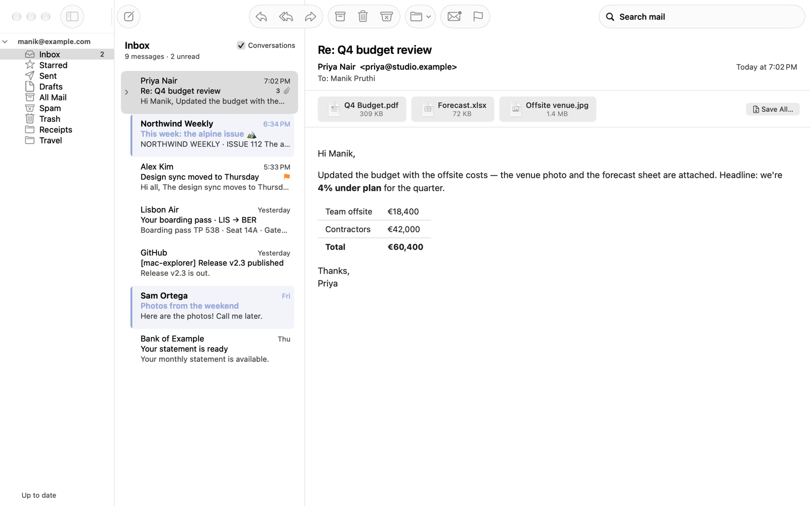
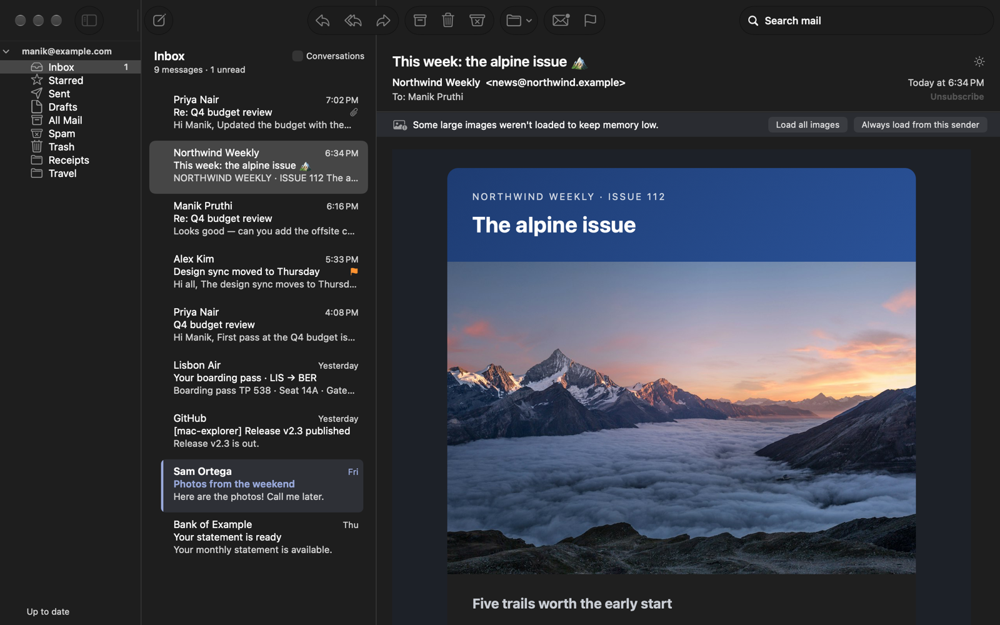
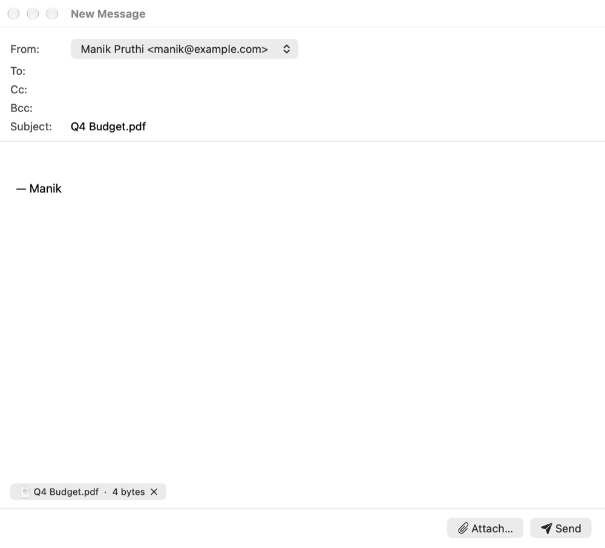

# Mac Mail

A small, fast, native macOS mail client for Gmail and other IMAP accounts. It opens in under half a second from an offline cache and syncs only what changed. Memory, measured with `footprint` (details under [Performance](#performance-measured-apple-silicon)):
- **The app itself:** about 60–65 MB with a real 2,800-message Gmail Inbox (about 50 MB with the demo mailbox).
- **WebKit, while you read:** about 50 MB more (email renderer plus graphics helper).
- **When you switch away for a minute (or minimise):** WebKit is shut down, so it drops back to the app alone.



Graphic emails look the way the sender designed them. Small images load automatically, and anything over the size limit shows a "Load image" box instead of using up memory. In dark mode, emails are recoloured to match the app, like Outlook; the ☀︎ button shows a message on its original light background.



## Features

- **Fast start.** The Inbox shows straight from the local cache. Then a delta sync (new mail since the last UIDNEXT, flag changes since the last MODSEQ) brings it up to date, usually in a second or less.
- **Push for new mail.** IMAP IDLE delivers new mail to the Inbox the moment it arrives, but only while the app is open.
- **Nothing in the background.** No helper processes or login items. Closing the main window quits the app (unsaved messages are offered Save / Discard first).
- **Light on memory while you're elsewhere.** A minute after you switch to another app (or right away when you minimise or hide it), the reading pane's WebKit processes are shut down and freed memory is returned to macOS. Coming back re-renders the open message in about 0.1 s.
- **Offline window.** Headers for the last 30 days (adjustable from 7 to 90) plus at least the newest 200 messages per folder are kept offline. Message text for the newest messages is prefetched so they open instantly. "Load older messages" fetches older mail on demand.
- **Search:**
  - Local results as you type (SQLite FTS5 over headers, plus the text of every message whose body is cached).
  - Gmail's own server search runs as soon as you pause, and its results merge in. If it fails, the list header says why. On other IMAP servers, queries IMAP can't express (`has:attachment`, non-ASCII text) stay local-only.
  - Text like `Re: budget` is searched as words; only known operators are treated as operators.
  - **Search syntax** works locally too: `from:`, `to:`, `subject:`, `has:attachment`, `is:unread`, `is:starred`, `newer_than:7d`, quoted values (`from:"divya k"`), and a space after the colon (`from: divya`). Other Gmail operators (`in:`, `label:`, `older_than:`…) are passed to Gmail.
  - **Filter bar** (shown while searching), like Outlook:
    - Scope: All folders, or the folder you were in.
    - Date: past week, month, 6 months or year.
    - Toggles: Unread, Flagged, Attachments.
    - **More**: From, To and Subject fields.
  - **Saved searches:** the search field's menu → *Save This Search…* (or Mailbox → Save Search…) saves the text together with the filter-bar choices and the folder scope under *Saved Searches* in the sidebar; selecting one restores all of it, and right-click deletes it.
- **Paging.** The list shows 1,000 rows at a time. *Show more messages* pages in the next 1,000 from the cache, search results included, before *Load older messages* asks the server for older mail in a folder.
- **Conversations on or off per folder.** Like Outlook, each folder can either group messages by conversation (threads expand in place) or show every message separately (⌥⌘C). Gmail threads use Gmail's own thread ids; other servers thread by `References` / `In-Reply-To`, falling back to subject plus participants (never subject alone).
- **Sort and density.** View → Sort By (newest, oldest, sender, subject) and View → Compact Rows (two-line rows). Newest and oldest are applied by the list's query (search results are reordered in memory), so the loaded page and *Load older messages* both follow that direction; sender and subject sort the loaded page.
- **Preview pane**, with a three-pane layout: folders, list and message.
- **Open in a separate window**, like Outlook:
  - Double-click a message (or press Return) to open it in its own window.
  - The window has Reply, Reply All, Forward, Archive, Delete, Spam, Read/Unread and Flag, and the usual shortcuts work there.
  - The window closes when you archive or delete the message. Drafts open in the editor instead.
- **Theme.** The app follows macOS light/dark by default, switching live. You can also pin Light or Dark in Settings → General or View → Appearance.
- **Dark reading pane:**
  - The reading pane uses the app's background.
  - In dark mode, each email gets an Outlook-style pass: light backgrounds are darkened (keeping their hue) and dark text on dark backgrounds is lightened. Images, gradients and brand colours aren't touched.
  - **View → Show Message with Light Background** (⌥⌘L, or the ☀︎ button in the header) shows a message exactly as designed.
- **Unread mail is highlighted, Outlook-style:** a tinted row, an accent bar on the left edge, a bold sender, and an accent-coloured subject and time.
- **Right-click acts in place:**
  - Right-clicking a message runs the command on that message without selecting or opening it. So "Mark as Unread" stays unread instead of being marked read by the preview.
  - Right-clicking inside a multi-selection acts on the whole selection.
- **Smart image loading:**
  - Images up to 2 MB each (10 MB and 60 requests per message) load automatically. `http://` images are fetched over https instead, redirects are followed only to https on public hosts, and addresses on your local network are never contacted. Images are shrunk to at most 2400 px, so a 6000 px photo uses about 10 MB of memory instead of about 140 MB.
  - Bigger images show a "Load image · 4.3 MB" box. Click it to load just that one, or use "Load all images" / "Always load from this sender".
  - Tracking pixels (including CSS-sized ones) are removed. A strict Content-Security-Policy blocks anything the sanitiser misses; it is placed at the very start of the page, before anything the sender wrote, so a `<head>` hidden in a comment or a title can't leave it out.
  - Images in Spam never load on their own.
  - Shrunk images are cached on disk (200 MB cap).
- **Attachments:**
  - Click a chip (or right-click → Save As…) to save one attachment.
  - Right-click → **Quick Look** previews it; **drag a chip** to Finder or another app to copy it there (downloaded on drop).
  - **Save All…** zips every attachment into one `.zip`. While a save runs, the chips are disabled so a second one can't start.
  - Downloads stream in 8 MB chunks, so a 25 MB file never sits in RAM, and are checked against the size the server announced.
- **Save As and saved messages (.eml):**
  - **File → Save As…** (⌘S) saves the open message, exactly as it arrived (headers, text, HTML and attachments), as a standard `.eml` file.
  - Double-clicking a `.eml` file (or File → Open Saved Message…, ⌘O, or dropping it on the Dock icon) opens it in Mac Mail **offline**: a window with the header, the message rendered with the same protections as the reading pane (scripts off, internet images only on request, inline images from the file itself) and its attachments (save, Quick Look, drag). Reply works too.
  - `.eml` is the format Apple Mail, Outlook and Thunderbird use, so a saved message opens on anyone's Mac or PC.
- **Print** (⌘P) the open message.
- **Writing mail:**
  - New message, Reply, Reply All and Forward. Forward includes the original attachments; Send waits until they're downloaded. If the original's text isn't cached yet, it's fetched before the composer opens.
  - Replies and forwards show the original email under what you type, rendered the way it looked; drag the divider to resize it. That's what's quoted when you send. Untick "Include original message" to leave it out.
  - Drag an address between To, Cc and Bcc to move it. Copy and paste still copies.
  - Replies clean up addresses that some senders write as links (`<mailto:help@bank.in.>`), which Gmail would otherwise reject with "553-5.1.3 not a valid RFC 5321 address".
  - **Formatting bar**, Outlook-style but minimal: font (System, Arial, Helvetica, Verdana, Georgia, Times New Roman, Courier New, or More Fonts… for the font panel), size (10–32 pt), **B** / *I* / U / S toggles that light up for the text under the cursor, text colour (Automatic follows light/dark mode, six preset colours, More Colours…) and clear formatting. ⌘B, ⌘I and ⌘U work too, everything undoes with ⌘Z, and links are kept. Formatting goes out as plain inline HTML (`<b>`, `<i>`, `font-size`, `font-family` with a serif/sans-serif/monospace fallback), so it looks the same in Outlook, Gmail and Apple Mail; unformatted mail is sent exactly as before.
  - Per-account signatures.
  - Send stops on anything in To, Cc or Bcc that isn't a complete address (a bare name, an address with a space) instead of sending to everyone else and leaving that person out.
  - Address autocomplete from your mail.
  - Drafts saved to the server, with Bcc, attachments and reply threading restored when you reopen one. Reopened attachments are downloaded before Save or Send is allowed, and the old draft is removed only after its replacement is confirmed on the server (found by its Message-ID, never by subject). If the old draft's row can't be removed from the local cache, a message says so and the failure is logged; the row goes after the next Drafts sync.
  - **Autosave:** every open composer is saved locally a few seconds after each change. After a crash or forced quit, unsent messages reopen at the next launch ("Recovered unsent message").
  - Quitting with an unsaved message asks Save / Discard / Cancel. A message in its Undo Send countdown is kept as a draft until the server accepts it, so a failed send or quit never loses it. A send that fails leaves one draft, not two: that copy replaces the draft the message was opened from, the reopened composer takes it over (sending again or saving replaces it), and Don't Save removes it if the message had no draft before.
  - If an attachment or picture of a reopened draft (or a forwarded message) can't be downloaded, the status line says so, Send asks before going without it, and saving keeps the earlier draft that still has it.
  - **Outbox:** sending while offline (or while the server can't be reached) puts the finished message in the Outbox instead of failing. It goes out by itself when the network is back, when you return to the app, or when you click the sidebar status. A message is only listed as queued once its record has been read back from disk, and an unreadable record is moved to an `Outbox Corrupt` folder instead of being silently lost (see [Outbox troubleshooting](#outbox-troubleshooting)).
  - **Images go in the body, like Outlook.** Paste a screenshot or a copied picture, or paste or drop image files copied in Finder or Mac Explorer, and they appear inline where the cursor is. Other files (and images over 20 MB) are attached. Inline images are sent as standard `cid:` parts (multipart/related), so they show in the body in Apple Mail, Outlook and Gmail. HEIC, TIFF and other formats those apps can't show inline are converted to JPEG (or PNG when transparent). **Resize** an image like in Outlook: click it and drag a corner handle (the aspect ratio is kept; ⌘Z undoes), or right-click → **Image Size** (Small, Medium, Large, Fit to Window, Original Size). Click a selected image and drag it to move it. The size you pick is the size recipients see, and the full-resolution image is still sent. Images and their sizes stay in autosaves and saved drafts. The editor shows a screen-sized copy, so a large photo doesn't cost its full size in RAM. The window title follows the subject.
  - Changing the From account swaps in that account's signature, even if you typed below the old one.
  - Undo Send (10 s by default): click Undo, press ⌘Z or Esc (outside a text field), or use Edit → Undo Send. Undo is only possible while the countdown runs; once the upload starts the toast says it's too late rather than pretending.
  - If the original message can't be loaded for a reply or forward, you're asked whether to continue without it.
  - Addresses are checked before sending; anything with control characters, extra angle brackets or quotes is refused, so a crafted name or `mailto:` link can't add hidden recipients or headers.
- **Mail actions:** read/unread, flag, archive, delete, report spam / not spam, and move to any label or folder. Actions apply instantly and are queued for the server, so they also work offline. Queued actions are sent after every sync, reconnect and when the app becomes active; temporary server refusals are retried, and a message whose move is refused reappears. The sidebar shows "N actions waiting" while anything is queued.
  - **Undo** for archive, delete, move and spam: the toast's Undo button (8 s) puts the messages back; the server is only told once the undo window closes (or at quit). Emptying Trash or Spam, or deleting or renaming a folder, first sends the waiting actions that involve that folder; actions in other folders and accounts keep their Undo. Removing an account drops its waiting actions.
  - **Archive** goes to Gmail's All Mail, or to the account's Archive folder elsewhere. An account without one gets an "Archive" folder created on the server; Archive never falls back to Trash.
  - **Empty Trash / Empty Spam** (Mailbox menu, or right-click the folder), after a confirmation. From All Inboxes or another unified view, the command covers that folder in every account, with one confirmation and an aggregate count.
  - **Folders:** right-click a folder for New Folder Inside…, Rename… and Delete Folder…, or an account for New Folder…. System folders can't be renamed or deleted. A message just moved out of a folder has left it on the server before the folder is deleted.
  - Mark-all-as-read is deliberately not offered (too easy to trigger by accident).
- **Accounts:**
  - Gmail (App Password) and other IMAP/SMTP servers, with **SSL/TLS** (993 / 465) or **STARTTLS** (143 / 587) for each side, a separate login name when it differs from the address, and a separate SMTP login if needed. Mac Mail never sends a password without TLS: a server that doesn't offer STARTTLS is refused.
  - Adding an account signs in to **both** IMAP and SMTP before anything is saved, and says which side failed.
  - **Edit Account / Sign in again** (Settings → Accounts → Edit Account…, or right-click the account): change servers, ports, security, logins or the password; the account reconnects with the new settings at once. A connection that was still opening with the old settings is closed, never handed to a waiting sync or search. **Save Without Verifying** stores the edit and password locally and reconnects in the background, so a wrong host or an offline Mac can still be fixed; cancelling during the check puts the old settings and password back.
  - Each account appears in the sidebar with its folders; right-click it for Sync Now, Edit Account, Notify About New Mail, New Folder, storage use (quota) and Remove. A sign-in problem shows a warning on the account row.
  - With more than one account, **All Accounts** shows All Inboxes, Flagged, Sent, Drafts, Archive and Trash across every account.
  - Choose a default account for new mail. A Keychain refusal when saving a password is shown instead of silently losing the old password.
- **Sharing files into a message:**
  - Mac Explorer's Share menu has **Email with Mac Mail**. Finder's *Open With*, dropping files on the Dock icon, and `mailto:` links all work too.
  - Each starts a new message with the files attached; folders are zipped first.
- **Spam:** Gmail filters spam on its own servers before mail reaches any app. Mac Mail shows the Spam folder, and its Spam / Not Spam buttons apply Gmail's real spam label, which trains Google's filter.
- **Other:**
  - Unread counts in the sidebar and Dock badge come from the server (IMAP `STATUS`), so they include mail older than the offline window; reading or moving mail updates them instantly. The badge can be turned off in Settings.
  - Notifications for new mail while the app is open (also when its window is hidden, minimised or on another Space); clicking one opens that exact message, and its **Mark as Read** / **Archive** buttons act without opening the app. macOS asks for permission when you turn them on (or add your first account); if macOS is blocking them, Settings says so and links to System Settings. Turn them off per account in Settings or the account's right-click menu.
  - **Settings → Storage:** cache sizes, outbox and queue state, last prune and last errors, read off the main thread when the tab opens; Prune Now, Clear Message Text Cache (with compaction; the pane says so if the file couldn't be compacted), Clear Image Cache, and Export Diagnostics Log (connection/sync errors only, never mail content or passwords).
  - Unsubscribe when the sender supports it, after a confirmation that shows where it goes.
  - Replied messages show an arrow in the list. Swipe a row for Archive or Read/Flag.
  - Reading-pane zoom (⌘+ / ⌘- / ⌘0) and the light-background choice are remembered (zoom globally, light background per sender).
  - VoiceOver reads each message row as one line (unread, flagged, sender, subject, time) and announces toasts.
  - Can be set as the default email app.
- **Native and small.** AppKit only, no third-party libraries, a 5.4 MB universal binary (Apple silicon + Intel).



## Requirements

- macOS 14 Sonoma or later (Apple silicon or Intel).
- A Gmail account with **2-Step Verification** turned on and an **App Password** (see Permissions), or any IMAP/SMTP account that accepts a password over TLS or STARTTLS.
- To build from source: Xcode Command Line Tools with Swift 6 (`xcode-select --install`).

## Install

### Option 1: DMG

1. Run `./package.sh` (or download a release), then open `release/MacMail-<version>-<build>-universal.dmg` (a `.sha256` checksum sits next to it). DMGs aren't committed to git; older ones in `release/` are kept.
2. Drag **Mac Mail.app** into `Applications`.
3. Open it from Applications. A locally built DMG is ad-hoc signed, so the first time, right-click → **Open**; a Developer ID build that `package.sh` notarised opens normally.
4. Click **Add Account…**, then enter your Gmail address and App Password.

### Option 2: Build from source

```bash
./build.sh            # debug build → ~/Library/Caches/MacMailBuild/Mac Mail.app
./build.sh release    # optimized universal build
./package.sh          # release build + release/MacMail-<version>.dmg
```

- `MAC_MAIL_ARCHS=arm64 ./build.sh` builds one architecture for faster local iteration; a release build refuses anything but both slices, and every build checks the slices are really there.
- `build.sh` compiles into a staging folder and replaces the previous app only after compiling and signing succeed, so a compile error never leaves you without a working build.
- The build number (`CFBundleVersion`) is the git commit count; the version comes from `Resources/Info.plist`. The macOS minimum is read from `LSMinimumSystemVersion` there too.
- `build.sh` runs the offline selftest first; `MAC_MAIL_SKIP_SELFTEST=1` skips it.
- Signing is ad hoc by default (`--timestamp=none`, hardened runtime, `Resources/MacMail.entitlements`), which keeps a Keychain grant tied to the exact binary. Set `MAC_MAIL_SIGN_IDENTITY="Developer ID Application: …"` for a Developer ID signature: `build.sh` signs with a secure timestamp, fails if the timestamp or hardened runtime is missing, and the Keychain grant survives updates.
- `package.sh` notarises, staples and verifies the DMG only when `MAC_MAIL_NOTARY_PROFILE=<notarytool profile>` is set; it refuses to notarise without a Developer ID identity, and with no profile it notes that the build isn't notarised.
- `package.sh` verifies the signature, includes LICENSE and README in the DMG, mounts the finished image to check the app inside, and writes a SHA-256 checksum.
- `tools/clean.sh` removes local build output and worker state.
- CI (`.github/workflows/selftest.yml`) runs the selftest and type-checks **every** source file on each push to `main` and each pull request.

To run the offline checks by hand:

```bash
tools/selftest.sh
```

## Permissions

- **Gmail App Password.** Gmail no longer accepts your normal password from mail apps. Create an App Password once:
  1. Turn on 2-Step Verification for your Google account.
  2. Open <https://myaccount.google.com/apppasswords> and create one (any name, for example "Mac Mail").
  3. Paste the 16-character password into Mac Mail. Spaces are fine.

  The password is stored only in the macOS Keychain. Revoke it at the same page at any time. No Google Cloud project or API key is needed.
- **Notifications** (optional). macOS asks when you turn on "Notify about new mail" in Settings or add your first account.

## Usage

- **⌘N:** new message. **⌘O:** open a saved `.eml` message.
- **⌘S:** save the open message as `.eml`. **⌘P:** print it.
- **⌘R / ⇧⌘R / ⌘J:** reply, reply all, forward.
- **⌘↩:** send. A toast offers **Undo** for 10 seconds; ⌘Z or Esc (outside text fields) and Edit → Undo Send do the same.
- **⌥⇧⌘⌫:** Empty Trash (Mailbox menu, with confirmation; from All Inboxes it empties every account's Trash).
- **⇧⌘A:** attach files. Dropping files on the message or the Dock icon also attaches them; image files dropped on the body go inline.
- **⇧⌘S:** save attachments (one opens a Save dialog, several save as a `.zip`).
- **⌫ / E / ⌃⌘A:** delete, archive.
- **⇧⌘J:** report spam / not spam.
- **⇧⌘U / ⇧⌘L:** mark read/unread, flag.
- **J / K:** next / previous message (also in a message window, with E and ⌫).
- Messages are marked read only when you open them (click, J/K, Return), not when the list auto-selects one at launch, after a folder switch, while typing a search or after archive/delete.
- **⌥⌘C:** turn conversation grouping on or off for this folder.
- **Double-click / Return:** open the message in its own window.
- **⌥⌘L:** show the open message with a light background (dark mode only).
- **Right-click a message:** Reply, Mark as Read/Unread, Flag, Archive, Delete, Spam or Move, on that message only. The selection doesn't change.
- **⌘1…⌘9:** go to the first nine folders. **⌃Tab:** move focus between sidebar, list and message.
- **Message → Move to…:** pick a folder with the keyboard.
- **⌘+ / ⌘- / ⌘0:** reading-pane zoom (works wherever focus is in the window).
- **⌥⌘F:** search all mail.
- **⌥⌘R:** sync now. **Click the sidebar status** to retry queued actions or messages in the Outbox; when the server refused a message, the click offers Retry or Delete for it.
- **⌘,:** Settings (accounts, signatures, appearance, offline window, image limits, Undo Send delay, default email app).
- **Double-click a draft:** continue editing it.

## How it works

- **Protocol.** The app talks to the server directly over IMAP and SMTP: implicit TLS (993 / 465) through `Network.framework`, or STARTTLS (143 / 587) on a Foundation stream that is upgraded to TLS in place (Network.framework can't upgrade a connection). After STARTTLS any bytes already read are discarded on the transport's own run-loop thread before the handshake, so plaintext can't be served as if it arrived over TLS, and capabilities are asked for again. SMTP signs in with AUTH PLAIN, or AUTH LOGIN where PLAIN isn't offered. It uses Gmail's IMAP extensions: `X-GM-THRID` for conversations, `X-GM-MSGID` to de-duplicate, and `X-GM-RAW` for real Gmail search. It also uses CONDSTORE for flag deltas, MOVE, and IDLE. A failed `SELECT` clears the remembered selection (the server deselects on failure), untagged data sent before IDLE's `+` is read through instead of leaving IDLE running under the next command, and a flag-only `FETCH` that arrives during a header fetch is never stored as a message.
- **Five connections per account**, each with its own job, so what you click never waits behind background work (Gmail allows 15):
  - *sync*: delta syncs and the queued actions.
  - *fetch*: what you click, such as message text, inline images and search. It's opened and pointed at the Inbox right at launch.
  - *prefetch*: background caching of message text, 10 messages per request.
  - *idle*: Inbox push.
  - *download*: attachment saves.

  A per-connection async gate keeps each "select folder → act" step together. Sign-in is TLS plus a single LOGIN (capabilities come back in the LOGIN reply).
- **Prefetch.** After each sync the newest messages' text is cached in batches. When you open a message, the next three (and the one above) are fetched too, so arrowing down the list is instant.
- **Never caches an empty message.** If Gmail sends no text for a message, it isn't saved, so opening it fetches again. Empty bodies left by older versions are cleared on launch.
- **Small updates.** Read/flag changes patch only the affected rows, with no full list reload. A sync announces only what actually changed, and a list reload that finds the same messages in the same order patches the changed rows in place instead of rebuilding every visible row. The sidebar status line has a fixed height, so status changes never shift the folder list.
- **Bounded server replies.** The deletion check after each sync asks only about cached UIDs (1,000 per command), and "Load older messages" pages backwards in bounded UID windows, taking the newest 200 below what's cached. A reply never grows with the size of the mailbox. The App Password is read from the Keychain once, off the main thread, and kept in memory.
- **Deleting for good.** Empty Trash / Empty Spam works the same way on every server. Actions still waiting for that folder (a move or delete into or out of it, in its Undo window or queued for the server) are sent first, so a message just deleted goes with the rest and one just moved out is kept; nothing else is committed early. The folder is then selected fresh, its UIDs are snapshotted, and only that snapshot is flagged and expunged, never `1:*`: with UIDPLUS by `UID EXPUNGE` of the snapshot, without it by a bare `EXPUNGE` that runs only when the server's `\Deleted` set is exactly the snapshot. Messages another client had already marked deleted are never flagged again, so they are never unflagged either. With CONDSTORE the flag read and the `STORE` are tied together by `UNCHANGEDSINCE`: a message another client touched in between is refused by the server, listed in `[MODIFIED]`, and the command stops with "the folder changed". Whenever the command fails part-way (a flagging step, the check or the expunge itself), exactly the flags it added are taken back. Mail that arrived meanwhile survives. Folders over 50,000 messages are snapshotted in UID windows so no reply line exceeds the 1 MB limit. In a unified view the command runs in every account, each committing only its own waiting actions, and one account's failure doesn't stop the others. A queued permanent delete whose message is already gone from the server counts as done.
- **Headers.** Encoded display names are decoded one address at a time, so a decoded comma or quote ("Müller, Hans") can't split one sender into two, and a backslash-escaped quote inside a quoted name is honoured. Adjacent encoded words in one charset are joined as bytes before conversion, so a character split across two words still decodes. In a `.eml` file a MIME part without headers keeps its first paragraph.
- **Structure first.** Each message's MIME tree (`BODYSTRUCTURE`) is cached, so reading a message downloads only its text part. Inline images and attachments are fetched only when you look at them or save them.
- **Storage.** Mail is kept in SQLite (system `libsqlite3`, WAL, 2 MB page cache, owner-only file permissions) with FTS5 indexes for headers and cached message text. The schema is versioned (`PRAGMA user_version`) and migrates older caches in place. Queued actions remember the folder's UIDVALIDITY, so they're dropped instead of hitting the wrong message if Gmail renumbers a folder; every fetch checks UIDVALIDITY too. An empty or broken folder list never prunes the cache, and a cached folder is only dropped once two folder lists in a row leave it out (so a folder deleted in another mail client disappears after the second refresh). A folder list that couldn't be saved doesn't count as one of the two. Local deletes report failure: if the cache can't be updated after Empty Trash, Delete Folder or a sync that found messages removed on the server, the app says so, and the sync doesn't advance past the rows it couldn't remove. The body cache is capped by size, not row count. The message list loads small row objects and creates only the visible cells. Deleting messages, folders or accounts keeps the search indexes and the address-autocomplete list in step (`recursive_triggers`, explicit deletes). A refetched header updates every header field, not just flags. Folder, unified and flagged lists are ordered and windowed in SQL (newest or oldest, with an id tiebreak), so the displayed page is the right end of the folder and *Load older messages* walks the same direction; search results are ordered in memory and paged 1,000 at a time. `Store+ListQueries` holds those queries, and `Store+Maintenance` reads the Storage figures and clears the text cache on their own connections.
- **Pruning.** The cache is pruned to exactly the offline window from Settings (newest 200 per folder always kept) 20 s after launch, every 6 hours while the app runs, and when you change the window. It runs on a utility queue with its own SQLite connection, in batches of 500, so it never blocks the window. The image cache prunes itself every 200 new images.
- **Reading pane.** One reused `WKWebView` with email scripts disabled. Dark mode recolouring runs as an app-injected script in WebKit's separate client script world (`DarkReader` in `HTMLPrep.swift`), so it works even though the email's own scripts are off. Every remote image URL is rewritten to `lm://img/<render>/<n>`, served by the app's own loader. The render number makes the URLs unique to each message: WebKit caches by URL, and without it one email could show another email's pictures. The loader enforces the size limits and shrinks images with ImageIO. A content-blocking rule (installed before the first message renders) and a Content-Security-Policy stop WebKit from loading anything else over the network. HTML is sanitised off the main thread. Links open in your default browser.
- **Unread counts.** After each folder sync (and for every folder when the folder list refreshes) one `STATUS (UNSEEN)` command runs on the sync connection. The cache stores the server count with the local count at that moment, and shows `server + local changes since`.
- **Window size.** The reading pane keeps a stretchable spacer while WebKit is shut down, so the window never collapses to the header's height; a collapsed frame saved by an older build is discarded on launch.
- **Sending.** MIME is built off the main thread by hand (multipart/alternative plus base64 attachments encoded slice by slice, headers folded per RFC 5322, including a long plain subject, control characters stripped). The upload goes out in 256 KB slices with a 60 s idle limit per command and a size-scaled limit for the server's final answer, so a big attachment on a slow line isn't cut off by one overall deadline. A send is *waiting* (undoable), then *uploading* (not undoable), then done. If the connection drops after the server has the whole message but before it confirms it, the app does not queue it again: it reports "Delivery uncertain" and keeps the draft, because the message may already have been delivered. A message that can't be sent is parked in the Outbox as a folder with its `item.json` and `message.eml`; the record is written and read back before the queue reports it, and a half-written folder is removed (both files are written into a `.tmp` staging folder that is renamed into place in one step, so a crash mid-save leaves either a whole queued message or nothing that looks like one; the next launch finishes an interrupted rename). Quoted replies use a stricter sanitiser than the reading pane: no `<style>`, `<link>`, `on*` handlers or `javascript:`/`data:` links, and only https images.
- **Hardening.** The IMAP parser caps line length, literal size (64 MB; a larger one drops the connection instead of desynchronising it), nesting depth and response counts, and every connection has read timeouts, so a hostile or stuck server can't crash or hang the app. Only one copy of the app can run at a time. Gmail files the copy in Sent itself.

### Performance (measured, Apple silicon)

Real Gmail account unless noted:

- **Launch → window with the Inbox:** about 0.37 s.
- **Opening a cached message (text on screen):** 10–30 ms.
- **Opening an uncached message:** about 0.4–0.7 s, one round trip to Gmail.
- **Read/flag change:** only the changed rows redraw. A full list of about 2,800 rows reloads in about 4 ms when needed.
- **Memory** (real account, ~2,800-message Inbox, measured with `footprint`, WebKit helpers counted):
  - The app: about 60–65 MB once launch sync and text prefetch finish, and about 65 MB after opening the 10 newest messages.
  - WebKit while reading: about 45 MB for a plain message, and up to 130–180 MB (page plus graphics process) for image-heavy newsletters. Images are shrunk to at most 2400 px first, and older messages' images are dropped from WebKit's memory cache on each open.
  - WebKit's processes exit a minute after you switch away (or at once when minimised), leaving just the app.
  - Background text caching returns its temporary memory as it goes, and freed pages go back to macOS after each sync, prefetch and cache prune.
  - Demo mailbox, after opening four messages (`footprint`, main process): 49–51 MB in version 1.1.0, compared with 50–52 MB for 1.0.0 measured back to back on the same Mac. Message decoding, MIME building, image-cache file I/O and pruning moved off the main thread without adding in-memory caches.
- **Each new build or update** asks once for your login password so it can read the App Password from the Keychain: an ad-hoc signature is tied to the exact binary, so macOS treats every build as a new app. Choose **Always Allow**. A Developer ID–signed build (`MAC_MAIL_SIGN_IDENTITY`) keeps the grant across updates.

Timings can be reproduced with `MAC_MAIL_DEBUG=1 MAC_MAIL_BENCH=1`, which opens the 10 newest messages read-only and logs timings and memory (`MAC_MAIL_BENCH_OFFSET=N` starts further down the list).

### Limits

- No new-mail alerts while the app is closed. That's the price of never running in the background.
- Gmail's Snooze, Scheduled Send, Nudges and Confidential mode aren't available over IMAP.
- Sign-in is by password / App Password only. Outlook.com and Microsoft 365 (and Gmail without an App Password) need OAuth, which isn't supported yet: it needs registered OAuth client ids.
- Inline images are fitted to the window width when they're pasted (resize them afterwards), and images inside a forwarded or quoted original stay in the original. One From address and one plain-text signature per account; no rules, VIP or mute; no Gmail label editing.
- English only. No automatic updates: download a new DMG.
- Unlike Gmail on the web, loaded images come straight from the sender's server, so the sender can tell the message was opened. Use "Ask before loading any remote images" in Settings if that matters.
- Encrypted mail (S/MIME, PGP) and calendar aren't included.
- An image whose server offers no https version can't be shown (plain http is never used).
- Default builds are ad-hoc signed with the hardened runtime and no secure timestamp; they aren't sandboxed or notarized. A Developer ID build can be notarized with `package.sh`. The local cache, autosaves and outbox aren't encrypted (they're readable only by your user account).
- A message the server refuses stays in the Outbox until you act on it: click the sidebar status and choose Retry or Delete.
- Local search returns at most 2,000 matches, shown 1,000 at a time.
- On a server without CONDSTORE, Empty Trash can't tie its flag read to its `STORE`: if another mail client marks a message deleted in the instant between the two and the command then fails, the rollback also clears that one flag (the message itself is kept). Servers with CONDSTORE (Gmail, iCloud, Fastmail, Dovecot, most others) don't have this gap.
- The SQLite cache is still read and written on the main thread (bulk work such as pruning, clearing the text cache and the Storage figures runs off it).

### Outbox troubleshooting

Messages that couldn't be sent are kept in `~/Library/Application Support/MacMail/Outbox`, one folder per message holding `item.json` and `message.eml` (owner-only permissions). The sidebar status shows how many are waiting; click it to retry. Network failures keep retrying whenever the connection returns; a message the server refuses is retried on later flushes until five attempts have failed.

If a record can't be read back (damaged JSON, an unusable id, or a missing `message.eml`), it is moved to `~/Library/Application Support/MacMail/Outbox Corrupt` instead of being deleted, and the move is written to the diagnostics log (Settings → Storage → Export Diagnostics Log). Nothing else in the Outbox is affected. Items whose account was removed, and messages whose delivery is uncertain, show in the sidebar status too, where Retry or Delete is offered. If a message's folder can't be written or deleted, that decision is kept in a `<id>.decision` file beside it, so the message is never sent again by itself after a relaunch.

More detail: [docs/architecture.md](docs/architecture.md), [docs/security.md](docs/security.md) and the decision records in [docs/adr/](docs/adr/).

## Project layout

```text
mac-mail/
├── .github/workflows/       selftest CI
├── build.sh                 selftest + staged universal swiftc build, signed (hardened runtime;
│                            Developer ID gets a secure timestamp)
├── package.sh               release build + verified, versioned DMG + checksum; optional notarisation
├── Resources/
│   ├── Info.plist           bundle id, version, mailto: handler, .eml viewer type, Dock-drop type
│   ├── MacMail.entitlements hardened runtime, no exceptions
│   └── AppIcon.icns
├── Sources/
│   ├── App/                 main.swift, AppDelegate (menus, file/mailto handling), Snapshot (demo captures)
│   ├── Core/                SQLite wrapper; Store (cache, FTS, action queue) with Store+ListQueries
│   │                        (windowed SQL) and Store+Maintenance (stats, clear cache); models, Keychain, Prefs
│   ├── Net/                 TLS / STARTTLS transports, IMAP parser and client, SMTP client
│   ├── Mail/                MIME decoding, BODYSTRUCTURE, .eml reader, message builder, address/header safety, search parser
│   ├── Sync/                AccountEngine (sync, IDLE, actions, folders), MailService (undo, send states)
│   │                        with MailService+Offline (unverified account edits), Outbox, demo data
│   └── UI/                  main window, sidebar, message list, search filter bar, preview, message window, .eml viewer,
│                            shared message actions, image loader, attachments, compose (autosave, formatting bar), settings
├── Tests/SelfTest.swift     offline checks: protocol, MIME, .eml, cache, sanitiser, outbox, and a scripted
│                            IMAP server for Empty Trash failures, SELECT and IDLE state (tools/selftest.sh)
├── tools/
│   ├── selftest.sh
│   ├── clean.sh             removes build output and worker state
│   └── make_icon.swift      renders Resources/AppIcon.icns
└── docs/                    architecture.md, security.md, adr/, screenshots/
```

UI behaviour has an in-app check too. It runs ⌘1–9, pane focus, reading-pane zoom, Archive → Undo, Save As → opening the `.eml`, the message window size, To → Cc drag, the compose title and the quit-with-unsaved-message prompt through their real code paths in the demo mailbox and prints PASS/FAIL lines:

```bash
MAC_MAIL_DEMO=1 MAC_MAIL_DEMO_SELFTEST=1 "$HOME/Library/Caches/MacMailBuild/Mac Mail.app/Contents/MacOS/MacMail" 2>&1 | grep selftest:
```

Screenshots come from the built-in demo mailbox. It never touches the network for mail and keeps its data and settings apart from the real app (`~/Library/Application Support/MacMailDemo`, defaults domain `com.manikpruthi.macmail.demo`):

```bash
MAC_MAIL_DEMO=1 MAC_MAIL_DEMO_SELECT=1 MAC_MAIL_SNAPSHOT=/tmp/shot.png \
  "$HOME/Library/Caches/MacMailBuild/Mac Mail.app/Contents/MacOS/MacMail"
```

## License

MIT. See [LICENSE](LICENSE).
